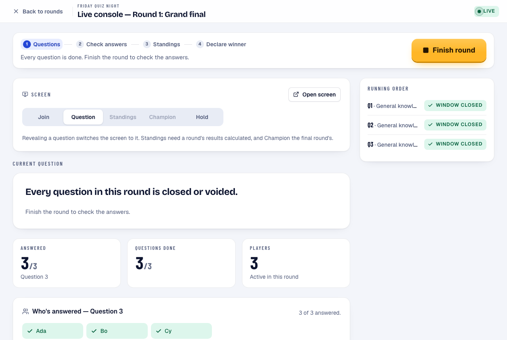
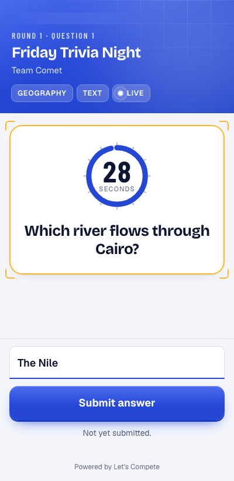
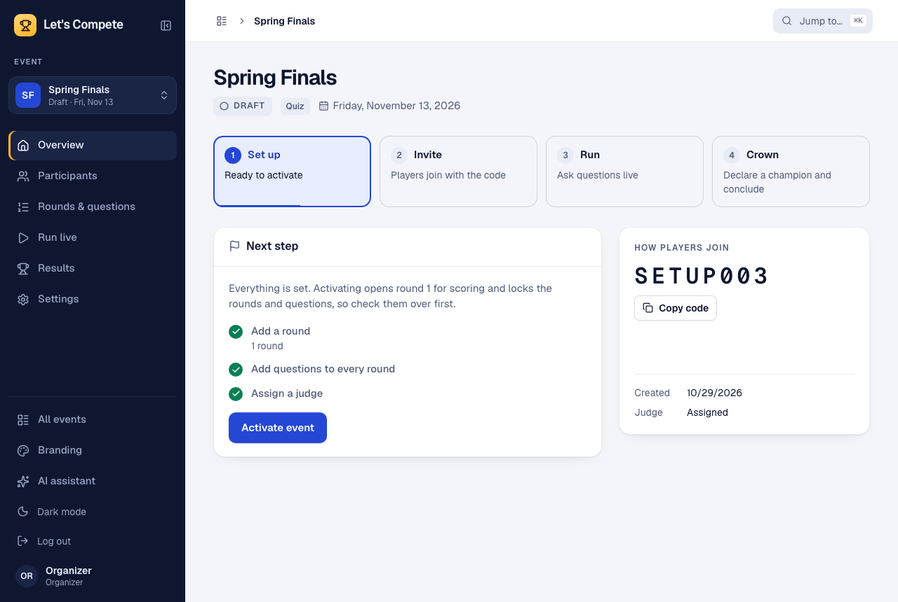
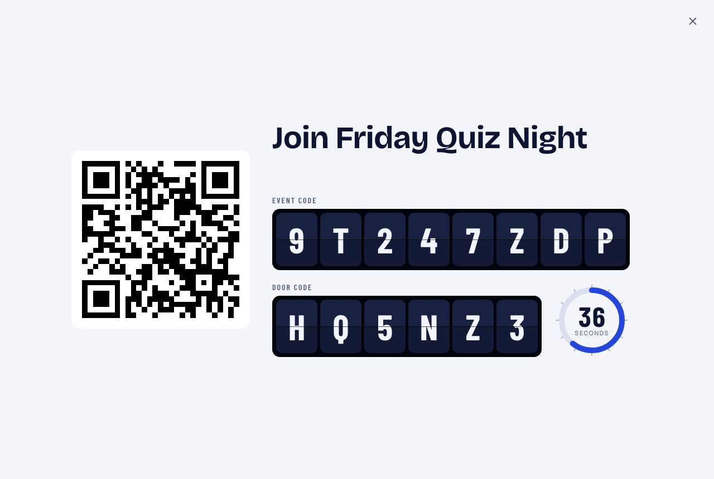
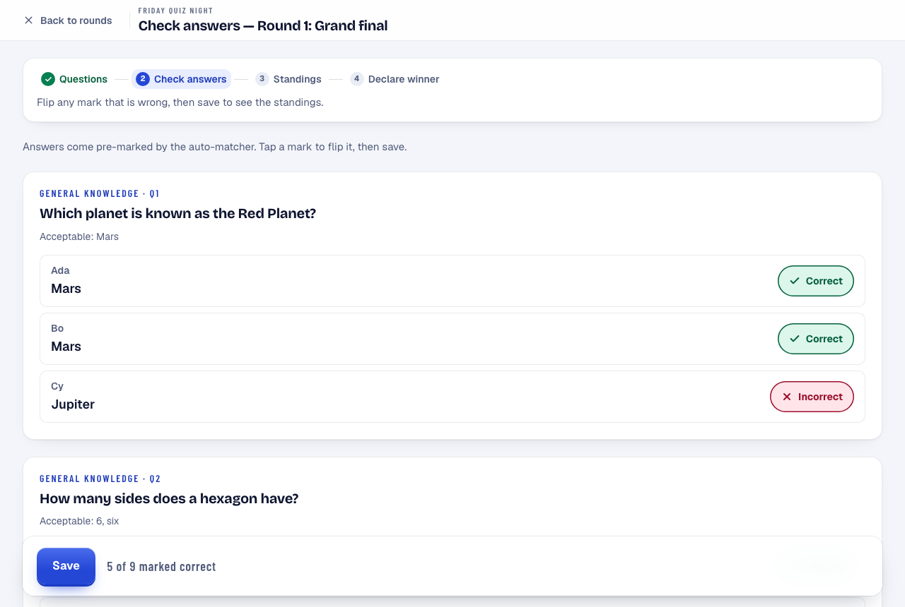
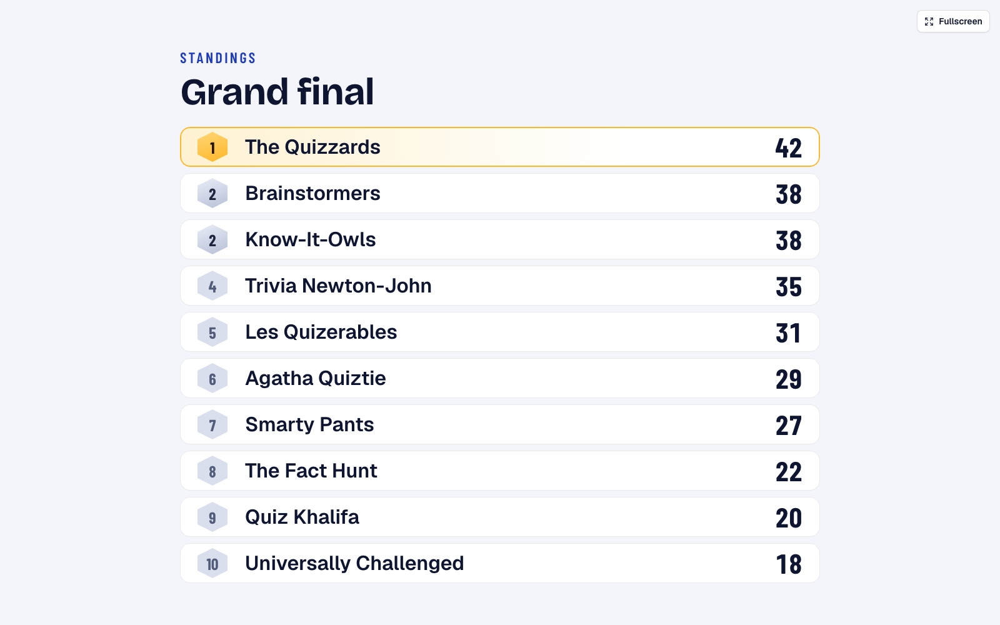
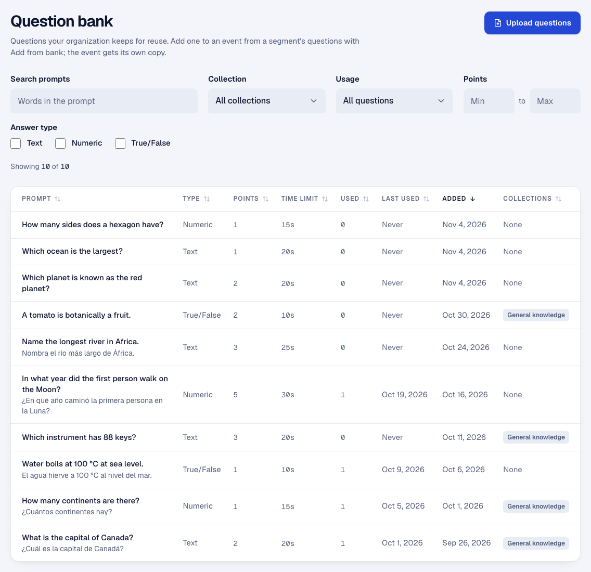
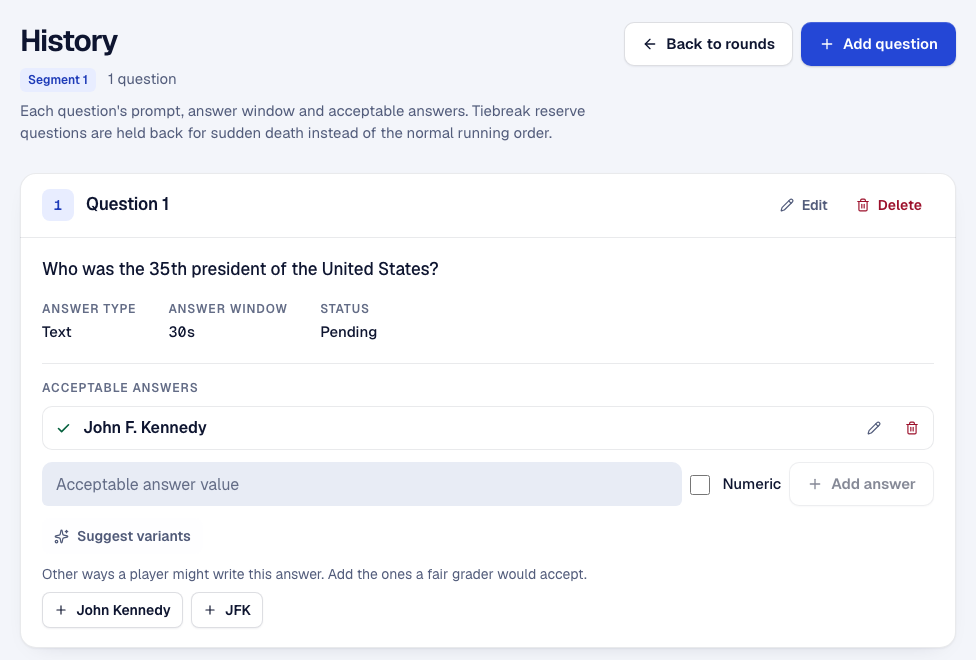
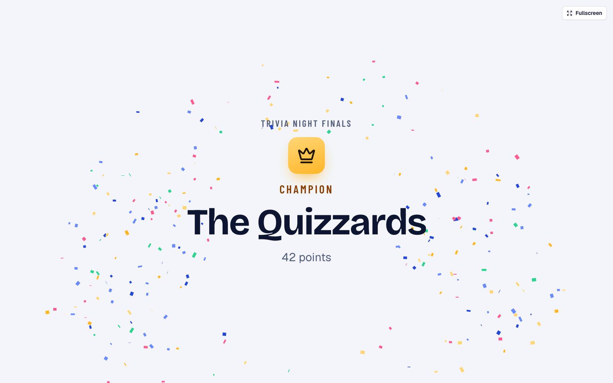
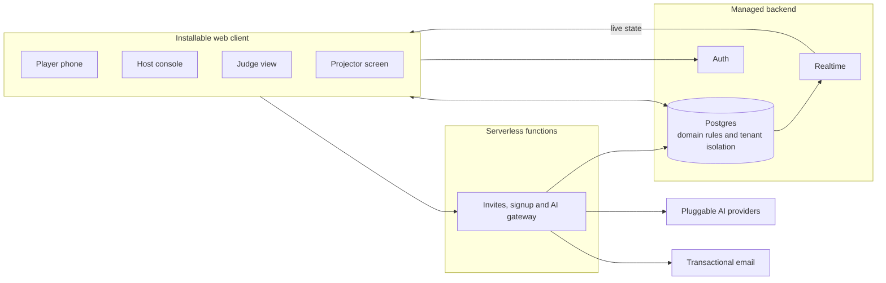

# Let's Compete

**A real-time platform for running live competitions.** Players answer timed questions on their phones, a judge confirms the results, the room follows along on a projector, and the app carries the event from the first question to a crowned champion.

This repository is a project showcase. The application source is private.

  
  &nbsp;
  

## The problem

A live quiz has three audiences who need different things at the same moment. The host needs control, the players need a fast and fair answer screen, and the room needs a scoreboard. Paper, spreadsheets and consumer quiz apps tend to break down when an event has elimination rounds, tied scores, a judge who must be able to overrule a mark, or a host who needs it under their own brand.

Let's Compete treats a competition as a governed, multi-stage process, with every step enforced by the system.

## How an event runs

| Stage | What happens |
| --- | --- |
| **Build** | Organizers structure rounds and segments, drawing from a reusable question bank or a CSV/Excel import. A readiness checklist blocks activation until the event is complete. |
| **Admit** | Players scan a QR code and enter an event code plus a door code that changes every minute, so a code shared outside the room stops working. Organizers control who gets in. |
| **Play** | The host reveals each question in two steps: everyone reads it, then the answer window opens for all players at once. |
| **Judge** | Answers arrive already pre-marked against the accepted answers. A judge reviews them and can overrule any mark before results are calculated. |
| **Advance** | Top finishers move on to the next round. Ties at the cutoff go to sudden death. |
| **Crown** | The champion is revealed on the big screen and every phone. Declaring a winner concludes the event and locks its scores. |

## Screens

<table>
  <tr>
    <td width="50%"> <b>Guided setup.</b> The event shows what's left to do before it can go live.</td>
    <td width="50%"> <b>Join screen.</b> A QR code, the event code and a rotating door code.</td>
  </tr>
  <tr>
    <td> <b>Judging.</b> Automatic pre-marks, with the final call left to a person.</td>
    <td> <b>Standings.</b> Projector view, with tied ranks handled.</td>
  </tr>
  <tr>
    <td> <b>Question bank.</b> Search, filters, collections, usage history and bilingual content.</td>
    <td> <b>AI assistance.</b> Suggests other ways a player might write a correct answer. The organizer decides which to accept.</td>
  </tr>
  <tr>
    <td colspan="2" align="center"> <b>The finish.</b> The champion reveal.</td>
  </tr>
</table>

## Architecture

| Layer | Technology |
| --- | --- |
| Client | React, TypeScript, Vite, Tailwind CSS, Radix primitives, installable PWA |
| Backend | Supabase: Postgres, Auth, Realtime, Storage |
| Serverless | Vercel Functions |
| AI | Provider-agnostic layer supporting Anthropic, OpenAI, Gemini, OpenRouter, Groq and local models |
| Testing | Playwright, axe-core, pgTAP |

### Engineering decisions

- **The database is the source of truth for the rules.** Lifecycle transitions, scoring and permissions live in Postgres behind row-level security and transactional functions. A modified client can't reveal a question early, submit after the window closes or read another organization's data.
- **Multi-tenant from the data layer up.** Organizations are isolated by policy, with distinct owner, admin, judge and player roles, plus an approval workflow for new organizations.
- **Server time decides.** Answer windows are enforced by the server, not the browser's timer, and the rotating door code corrects for each device's clock drift.
- **Fairness is a feature.** The answer screen detects when a player leaves it, applies a short grace period, and logs the event for the judge.
- **Humans stay in the loop.** Neither the auto-marking nor the AI makes a final decision. Automation drafts, and a person confirms.
- **AI is optional and bring-your-own.** Each organization connects its preferred provider or a local model. Hosted calls pass through authenticated, rate-limited functions.
- **White-labeling is built in.** Organizations get their own branded portal, with colors applied across the player experience.

## Quality

- **Database tests:** 41 pgTAP test files exercise security policies and domain rules directly in SQL.
- **End-to-end tests:** 59 Playwright browser specs run against a real local backend, with multiple simultaneous users, plus 25 fast unit specs.
- **Accessibility:** automated axe audits across the main screens, in light and dark themes.
- **Delivery:** every change goes through a pull request with version-controlled database migrations.

## By the numbers

*As of November 2026, about 10 weeks after the first commit.*

| | |
| --- | --- |
| Merged pull requests | 165 |
| TypeScript application code | ~30,000 lines |
| SQL migrations | 66 (~15,700 lines) |
| Test code | ~12,000 lines of TypeScript, plus the database suite |

## About this repository

Designed, built and operated as a solo project, covering product, UX, data modeling, security and delivery. The source code, schema and scoring logic are private, so this repository contains only this overview and sample screenshots. All data shown is fictional.

© 2026 Hubert Swearine. All rights reserved.
